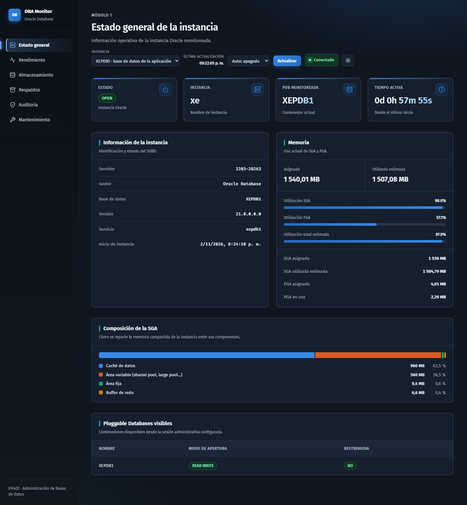
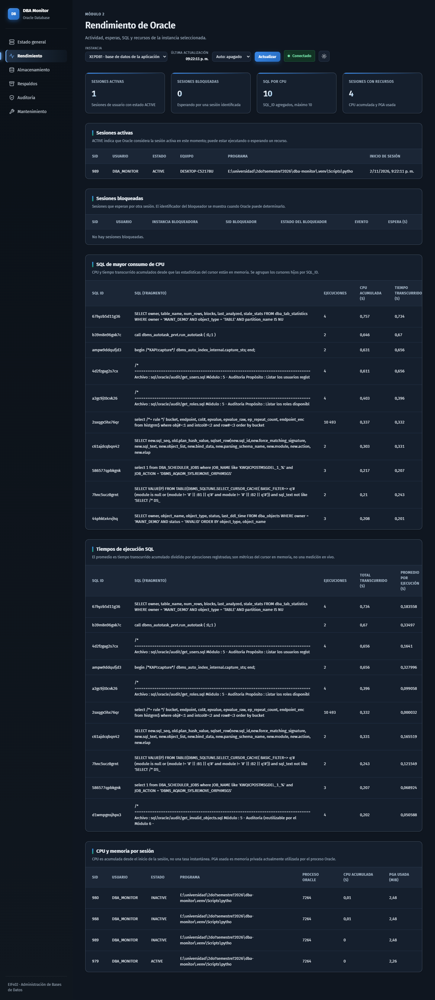
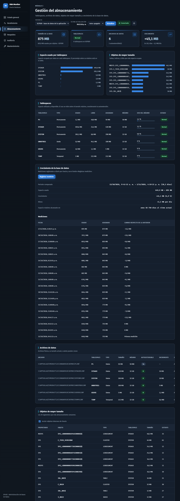
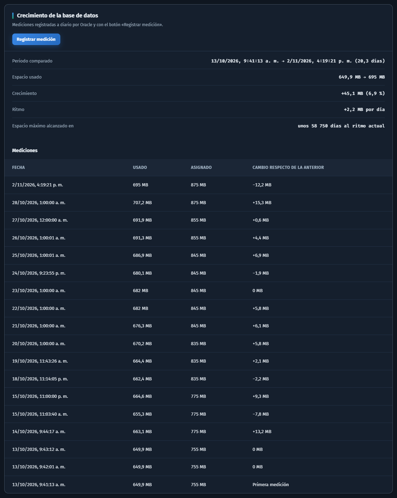
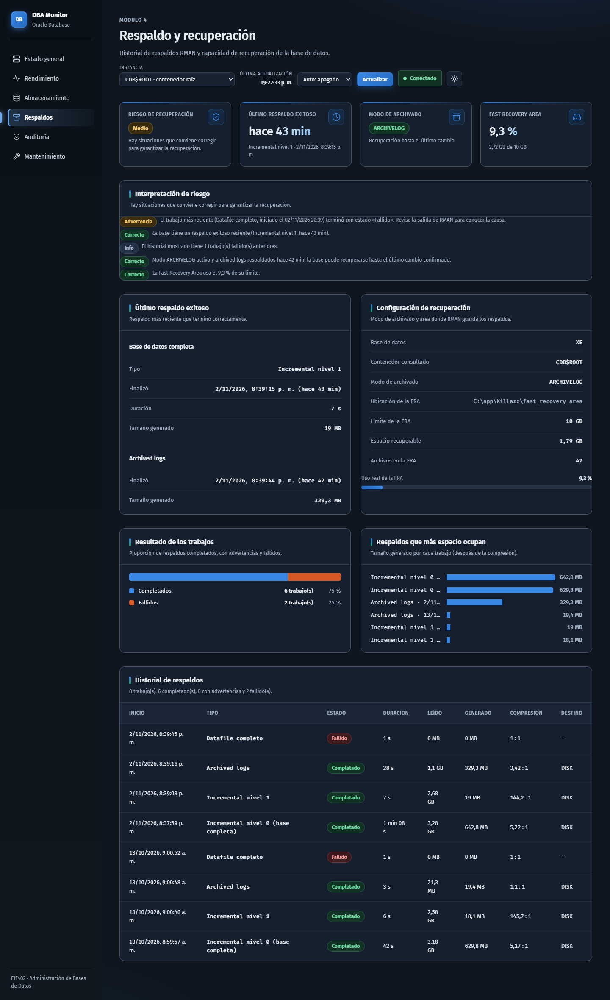
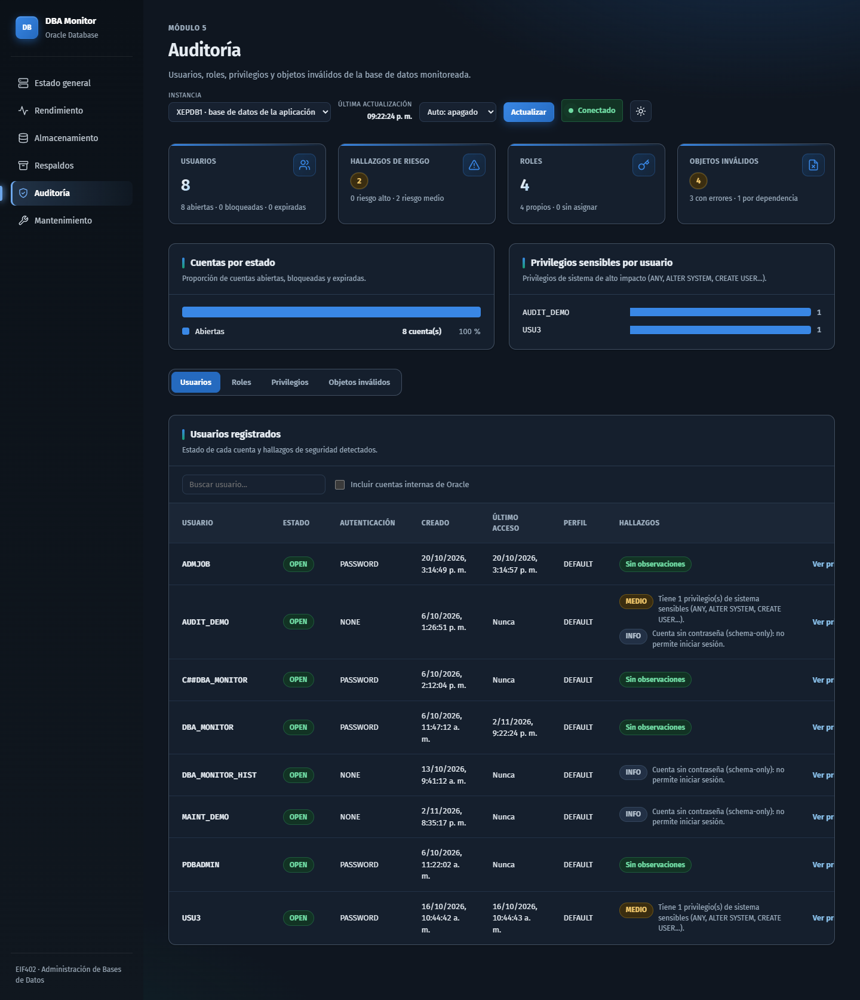
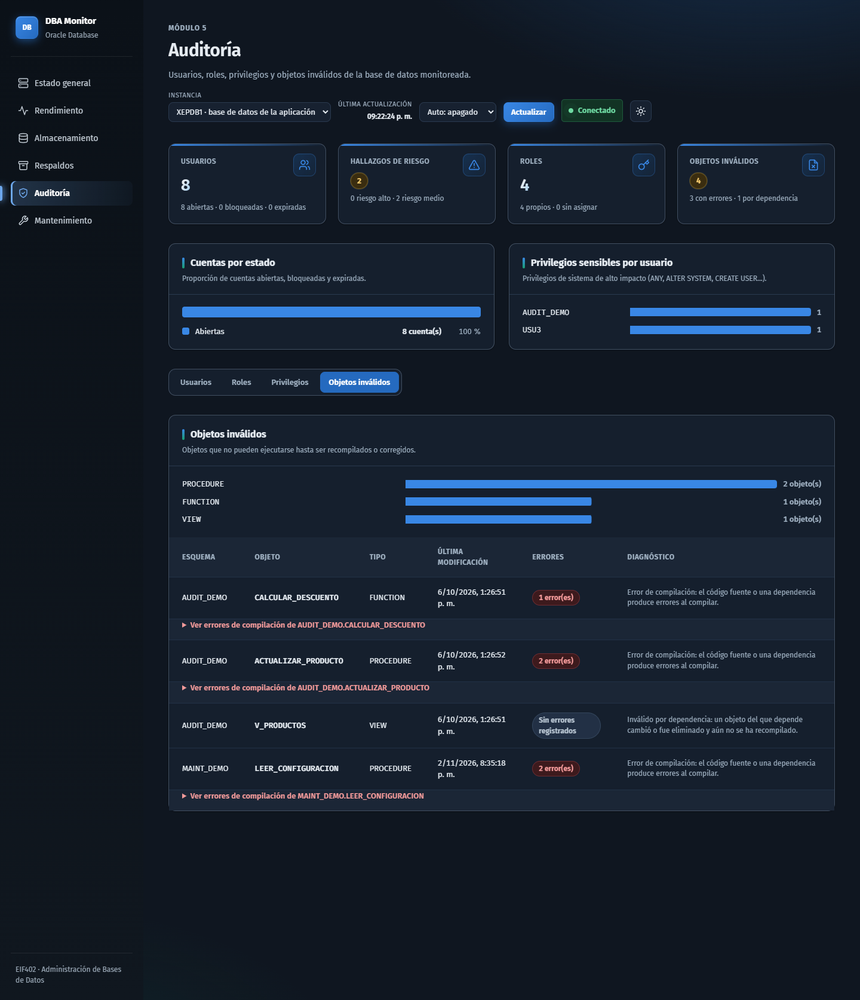
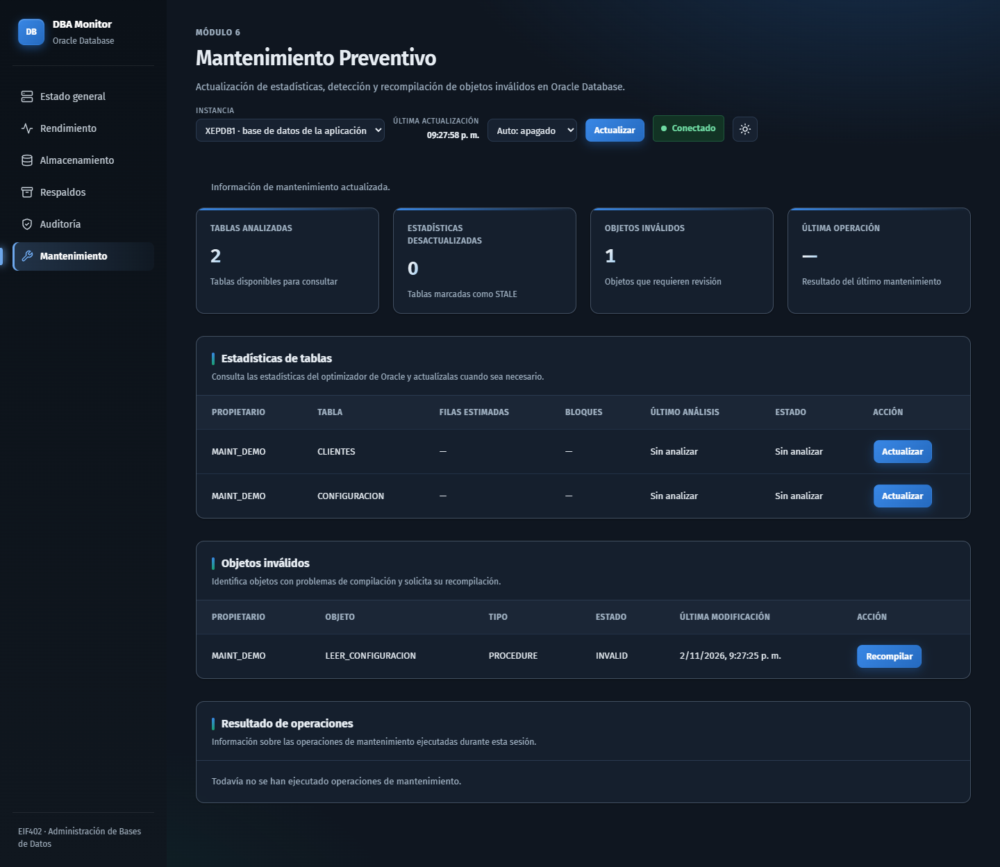
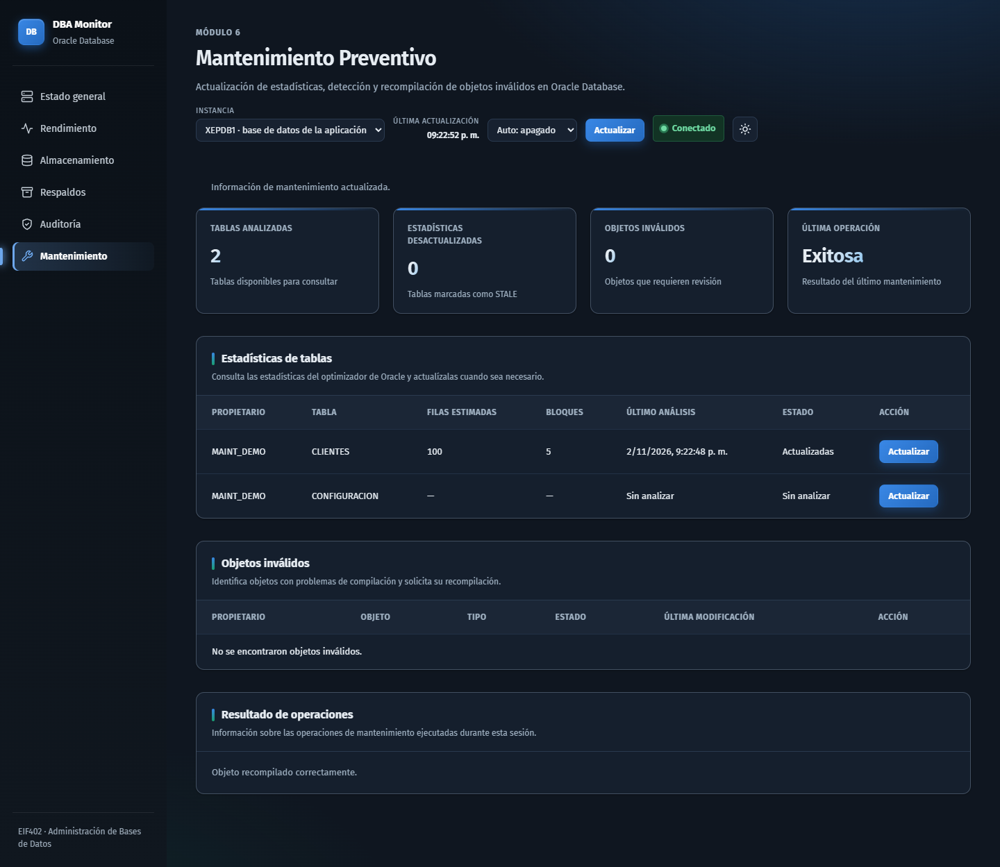

# Evidencias de pruebas

Pruebas realizadas el 2 de noviembre de 2026 sobre Oracle Database XE 21c
(`21.0.0.0.0`), instancia `xe`, con la versión final de `main`. Todos los
resultados provienen de consultas ejecutadas en vivo contra la base de datos.

## 1. Pruebas automatizadas

```powershell
python -m unittest tests.test_performance_repository tests.test_performance_service tests.test_performance_router
```

Resultado: `Ran 7 tests ... OK`.

Cubren el repositorio, el servicio y el router del módulo 2. La prueba
`tests/test_performance_http.py` consulta un servidor en ejecución y se corre
aparte con la aplicación iniciada.

## 2. Pruebas funcionales por módulo

Se consultó cada página y cada endpoint de lectura con la aplicación en
ejecución (`uvicorn app.main:app`).

| Módulo | Página / Endpoint | Resultado | Dato observado |
| --- | --- | --- | --- |
| Integración | `/`, `/rendimiento`, `/almacenamiento`, `/respaldos`, `/auditoria`, `/mantenimiento` | HTTP 200 | Las seis páginas cargan y se navegan desde el menú |
| 1 - Instancia | `GET /api/instance` | HTTP 200 | Gestor Oracle Database, instancia `xe`, versión 21.0.0.0.0, estado `OPEN` |
| 1 - Instancia | `GET /api/connections` | HTTP 200 | Perfiles `xepdb1` (activo) y `cdb_root`, sin contraseñas |
| 1 - Instancia | `PUT /api/connections/active` | HTTP 200 | Cambio a `cdb_root` y regreso a `xepdb1` sin modificar código |
| 2 - Rendimiento | `GET /api/performance/sessions` | HTTP 200 | Sesiones activas con usuario, equipo y programa |
| 2 - Rendimiento | `GET /api/performance/blocked-sessions` | HTTP 200 | Lista vacía: no había sesiones bloqueadas |
| 2 - Rendimiento | `GET /api/performance/top-sql` | HTTP 200 | SQL ordenado por CPU acumulada |
| 2 - Rendimiento | `GET /api/performance/query-times` | HTTP 200 | Tiempo total y promedio por ejecución |
| 2 - Rendimiento | `GET /api/performance/resource-usage` | HTTP 200 | CPU y PGA por sesión |
| 3 - Almacenamiento | `GET /api/storage` | HTTP 200 | En `XEPDB1`: 875 MB asignados y 687,81 MB usados |
| 4 - Respaldos | `GET /api/backup` (perfil `CDB$ROOT`) | HTTP 200 | Modo `ARCHIVELOG`; último incremental nivel 1 completado; FRA con 47 archivos y 9,3 % de uso |
| 4 - Respaldos | `GET /api/backup/history` (perfil `XEPDB1`) | HTTP 200 | Historial vacío: Oracle registra los respaldos a nivel de CDB |
| 5 - Auditoría | `GET /api/audit/users` | HTTP 200 | 8 usuarios registrados |
| 5 - Auditoría | `GET /api/audit/roles` | HTTP 200 | 4 roles |
| 5 - Auditoría | `GET /api/audit/invalid-objects` | HTTP 200 | 4 objetos inválidos, 3 con errores de compilación |
| 6 - Mantenimiento | `GET /api/maintenance/statistics` | HTTP 200 | 2 tablas de `MAINT_DEMO` |
| 6 - Mantenimiento | `GET /api/maintenance/invalid-objects` | HTTP 200 | `LEER_CONFIGURACION` (procedimiento) inválido |

Las operaciones que modifican datos (`POST /api/maintenance/...` y
`POST /api/storage/snapshot`) se prueban desde la interfaz durante la
demostración; sus capturas van en la sección 4.

## 3. Casos de error y robustez

| Situación | Comportamiento |
| --- | --- |
| Faltan permisos de Oracle sobre una vista (observado antes de ejecutar los scripts de permisos) | La sección muestra `ORA-00942` con una indicación de verificar la conexión y los permisos de `DBA_MONITOR`; el indicador pasa a "Datos parciales" o "Error al consultar" y el resto de la página sigue funcionando |
| Respaldos en el perfil `XEPDB1` (observado) | La página indica que no hay datos, en lugar de mostrar un diagnóstico falso |
| Sin sesiones bloqueadas (observado) | Mensaje "No hay sesiones bloqueadas", no un error |
| Mantenimiento en `CDB$ROOT` (según el código del servicio) | Mensaje claro: disponible únicamente en `XEPDB1` (HTTP 409) |
| Operación de mantenimiento sin `confirm` (según el código del router) | Rechazada con HTTP 400 |

## 4. Capturas de pantalla

Capturadas el 2 de noviembre de 2026 desde la aplicación en ejecución, con
datos reales de Oracle (tema oscuro, 1440 px de ancho). Están en
[`docs/evidencias/`](evidencias/).

| Módulo | Captura | Qué demuestra |
| --- | --- | --- |
| 1 - Instancia |  | Servidor, instancia `xe`, versión, estado `OPEN`, tiempo activo y memoria |
| 1 - Instancia |  | Selector de perfil de conexión y estado de la conexión |
| 2 - Rendimiento |  | Sesiones, SQL de mayor consumo, tiempos de ejecución y recursos |
| 3 - Almacenamiento |  | Tablespaces, archivos de datos y objetos de mayor tamaño |
| 3 - Almacenamiento |  | Historial de mediciones, crecimiento y ritmo por día |
| 4 - Respaldos |  | Perfil `CDB$ROOT`: último respaldo, interpretación de riesgo e historial RMAN |
| 5 - Auditoría |  | Usuarios registrados y hallazgos |
| 5 - Auditoría |  | Objetos inválidos con errores de compilación |
| 6 - Mantenimiento |  | Estadísticas sin analizar y procedimiento `LEER_CONFIGURACION` inválido |
| 6 - Mantenimiento |  | Estadísticas de `CLIENTES` calculadas, objeto recompilado y resultado "Exitosa" |

## 5. Cómo repetir las pruebas

1. Preparar Oracle con los scripts de la tabla del [README](../README.md).
2. Iniciar `uvicorn app.main:app`.
3. Abrir cada página y comparar con la tabla anterior, o consultar
   `http://127.0.0.1:8000/docs` y ejecutar los endpoints.
